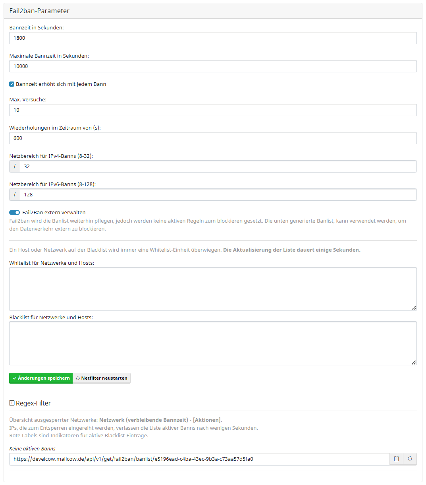
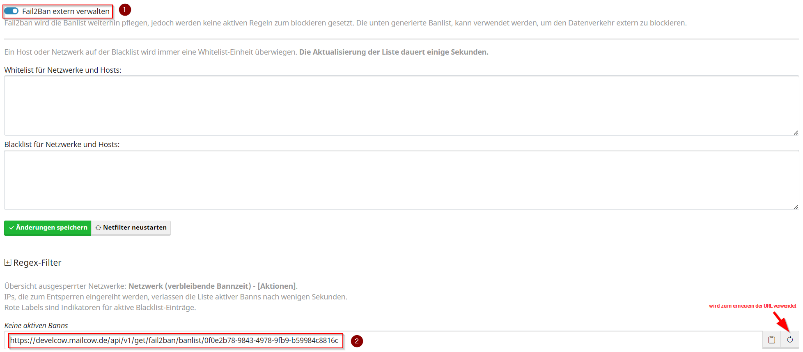

## So arbeitet Netfilter

Der Netfilter-Container liest die Logs der mailcow-Container und zählt fehlgeschlagene Anmeldungen pro Netzwerk. Erreicht ein Netzwerk die maximale Anzahl an Versuchen innerhalb des Zeitfensters, wird es für die Bannzeit gesperrt.

- **Netzwerke statt einzelner Adressen:** Die Größe eines gesperrten Netzwerks bestimmen die Netban-Präfixe für IPv4 und IPv6 (Standard `/32` und `/128`, also einzelne Adressen).
- **Wachsende Bannzeit:** Ist `Bannzeit erhöht sich mit jedem Bann` aktiv, dauert jede weitere Sperre desselben Netzwerks doppelt so lange, höchstens bis zur maximalen Bannzeit. Nach einem Neustart des Netfilter-Containers beginnt die Verdopplung von vorn, aktive Sperren bleiben.
- **Private Adressen** (z. B. `192.168.0.0/16` oder das mailcow-Netzwerk) und Loopback werden nie gesperrt.
- **Aktive Sperren überstehen Neustarts:** Sie liegen mit ihrem Ablaufzeitpunkt in Redis. Nach einem Neustart des Netfilter-Containers (z. B. durch `update.sh`) werden sie wieder gesetzt, abgelaufene fallen weg.
- **Entsperren:** Abgelaufene und in der UI entsperrte Sperren werden innerhalb von etwa 10 Sekunden aufgehoben.

### Was als Fehlversuch zählt

Gezählt werden:

- Fehlgeschlagene Anmeldungen an IMAP, POP3, SMTP (AUTH) und Sieve. Dovecot lässt das Passwort von der mailcow UI prüfen, die den Fehlversuch meldet.
- Fehlgeschlagene Anmeldungen an ActiveSync und CalDAV/CardDAV, mit der Adresse des Clients.
- Fehlgeschlagene Anmeldungen an der mailcow UI und an SOGo, auch falsche 2FA-Codes.
- Fehlgeschlagene Anmeldungen von Dovecot-Master-Usern.

Protokolliert, aber **nicht** gezählt werden Anmeldungen mit richtigem Passwort, die das Konto nicht erlaubt. Sie stehen im Log des php-fpm-Containers als `Login denied`, zum Beispiel:

- das Protokoll ist für die Mailbox abgeschaltet, oder Mailbox oder Domain sind inaktiv,
- eine geteilte Mailbox, die keine eigene Anmeldung hat,
- eine Mailbox mit 2FA, die im Mail-Client ihr Passwort statt eines App-Passworts nutzt,
- ein inaktives App-Passwort oder eines ohne das Protokoll.

Ein falsch eingerichteter Mail-Client sperrt so nicht ein ganzes Netzwerk, etwa ein Büro hinter NAT. Falsche Passwörter zählen weiterhin.

!!! warning "Reverse Proxy"
	Läuft mailcow hinter einem Reverse Proxy mit einer Adresse außerhalb der privaten Bereiche, gehört dieser in `TRUSTED_PROXIES` in der `mailcow.conf`. Sonst zählen fehlgeschlagene ActiveSync- und CalDAV/CardDAV-Anmeldungen aller Clients für die Adresse des Proxys, und der Proxy wird gesperrt.

## Netfilter Ban-Einstellungen ändern

Die Netfilter Ban-Einstellungen liegen unter `Konfiguration -> Server-Konfiguration -> Konfiguration -> Fail2ban-Parameter`.

Dort erscheint dieses Fenster:

Hier lassen sich verschiedene Optionen für die Banns festlegen, zum Beispiel die max. Ban-Zeit oder die max. Versuche, bevor ein Ban ausgeführt wird.

Änderungen greifen nach etwa 10 Sekunden, ohne Neustart.

### Allowlist und Denylist

- **Allowlist:** Adressen und Netzwerke, die nie gesperrt werden.
- **Denylist:** Adressen und Netzwerke, die dauerhaft gesperrt sind. Ein Eintrag auf der Denylist hat Vorrang vor der Allowlist.

Beide Listen nehmen auch Hostnamen an, die zu ihren IPv4- und IPv6-Adressen aufgelöst werden. Netfilter übernimmt Änderungen innerhalb einer Minute, ohne Neustart. Lässt sich ein Hostname zeitweise nicht auflösen (DNS-Timeout), bleiben seine zuletzt bekannten Adressen bestehen.

## Netfilter Regex ändern

!!! danger "Achtung"
	Folgender Bereich erfordert zumindest grundlegende Regex-Kenntnisse.  
	Wer sich nicht sicher ist, was dort passiert, sollte die Regeln besser nicht umkonfigurieren.

Neben den Sperreinstellungen lässt sich auch festlegen, was genau aus den Logs der mailcow-Container verwendet wird, um einen möglichen Angreifer zu sperren.

Dafür das Regex-Feld aufklappen. Dort lassen sich die Regeln ändern oder neue anlegen. Die Standard-Regeln:

| ID | Logzeilen |
| --- | --- |
| 1 | Fehlgeschlagene Anmeldungen an der mailcow UI, ActiveSync und CalDAV/CardDAV, falsche 2FA-Codes |
| 2 | Fehlgeschlagene Anmeldungen an der Rspamd UI |
| 3 | Fehlgeschlagene Anmeldungen an IMAP, POP3, SMTP und Sieve |
| 4 | Nicht-SMTP-Befehle an Postfix |
| 5 | SMTP-Protokollfehler |
| 6 | Fehlgeschlagene SOGo-Anmeldungen |
| 7 | SOGo-Anfragen, die mit `403` beantwortet werden |
| 8 | Fehlgeschlagene Anmeldungen von Dovecot-Master-Usern |

- Die erste Gruppe einer Regel (`(...)`) muss die Adresse des Clients erfassen.
- Die Regeln werden in der Reihenfolge ihrer ID geprüft. Eine Logzeile zählt als ein Fehlversuch, auch wenn mehrere Regeln passen.
- Eine Regel mit ungültiger Regex wird übersprungen und geloggt, die anderen Regeln arbeiten weiter.

!!! info "Hinweis"
	Die Standard-Regeln sind am Anfang der Logzeile verankert (`^`), damit Text, den Clients bestimmen (z. B. ein Login-Name), nicht passt. Eigene Regeln sollten genauso verankert sein.  
	Updates ersetzen frühere Standard-Regeln automatisch, wenn sie nicht geändert wurden. Geänderte oder eigene Regeln bleiben erhalten und sollten nach einem Update geprüft werden. Fehlgeschlagene SMTP-Anmeldungen kommen jetzt aus Regel 3, eine Regel für das Postfix-Log (`SASL ... authentication failed`) würde sie doppelt zählen. `Zurücksetzen auf Standard` stellt die Standard-Regeln wieder her.

## Ausfall des Identity Providers

Kann mailcow bei einer Anmeldung den Identity Provider (LDAP, Keycloak) nicht erreichen, schlägt die Anmeldung mit einem temporären Fehler fehl und zählt **nicht** als Fehlversuch:

- **mailcow UI:** zeigt „Der Identity Provider ist nicht erreichbar, bitte später erneut versuchen.“
- **IMAP/POP3:** Mail-Clients bekommen einen temporären Fehler (`[UNAVAILABLE]`) und versuchen es später erneut.
- **SMTP:** Die Anmeldung schlägt fehl, zählt aber nicht.

Mail-Clients, die sich vorher erfolgreich angemeldet haben, arbeiten während des Ausfalls weiter, solange Dovecot ihre Anmeldung im Cache hat.

## Firewall-Regeln

Netfilter hält seine Regeln in der Chain `MAILCOW`, auf die als erste Regel der Chains `INPUT` und `FORWARD` gesprungen wird.

- **Reihenfolge:** Docker setzt bei einem Neustart seine eigenen Sprünge (`DOCKER-USER`, `DOCKER-FORWARD`) an den Anfang. Netfilter prüft die Reihenfolge alle 10 Sekunden und schiebt den Sprung auf `MAILCOW` wieder nach oben. Fehlt die Chain (z. B. nach einem Firewall-Reload auf dem Host), legt Netfilter sie samt aller aktiven Sperren neu an.
- **Isolation:** Die Regel `mailcow isolation` sperrt den Zugriff von außerhalb des mailcow-Netzwerks auf die Ports von MariaDB, Redis, Solr und doveadm (3306, 6379, 8983, 12345). Es gibt eine Regel pro Port, damit Werkzeuge, die das Regelwerk mit `iptables-save` sichern und wiederherstellen (z. B. `netfilter-persistent`), die Ports behalten. Mit `DISABLE_NETFILTER_ISOLATION_RULE=y` in der `mailcow.conf` lässt sich die Regel abschalten; nach einem Neustart des Netfilter-Containers werden auch bestehende Regeln entfernt.
- **Stoppen:** Beim Stoppen entfernt der Netfilter-Container seine Regeln. Die aktiven Sperren bleiben in Redis und werden beim nächsten Start wieder gesetzt.

## Netfilter Entscheidungen via URL als Quelle für Firewall Blockregeln bereitstellen

!!! info "Hinweis"
	Die Option ist standardmäßig deaktiviert und muss erst aktiviert werden.

Seit dem 2023-12 Update bietet mailcow die Möglichkeit, die Netfilter-Entscheidungen als externen Endpoint zu exportieren, um die Daten daraus in ein externes Firewall-System einzubinden, quasi als Blocklisten-Quelle.

??? question "Was bringt diese Funktion?"
	Damit lassen sich die von Netfilter als gesperrt markierten IPs an einen Endpunkt weitergeben, der diese IPs dann verarbeiten kann. Bspw. kann eine OPNsense-Firewall diese Liste dynamisch laden.

Schauen wir uns die Einstellungen dazu an:

Um die generelle Funktion zu aktivieren, muss der Haken bei `Fail2Ban extern verwalten` gesetzt werden.

Sobald das erledigt ist, kann die URL (Punkt 2) kopiert und im jeweiligen Endpunkt eingesetzt werden.

!!! warning "Wichtig"
	Die URL kann bei Bedarf neu erzeugt werden. Dafür auf das Symbol neben Kopieren `Neuladen Symbol` klicken.
