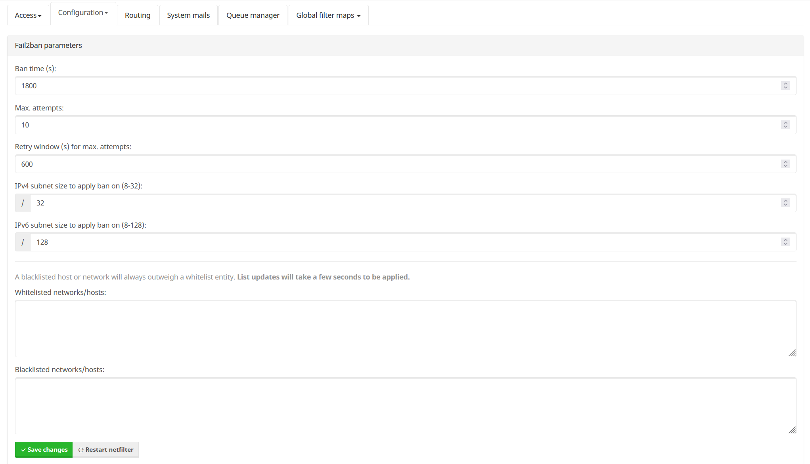
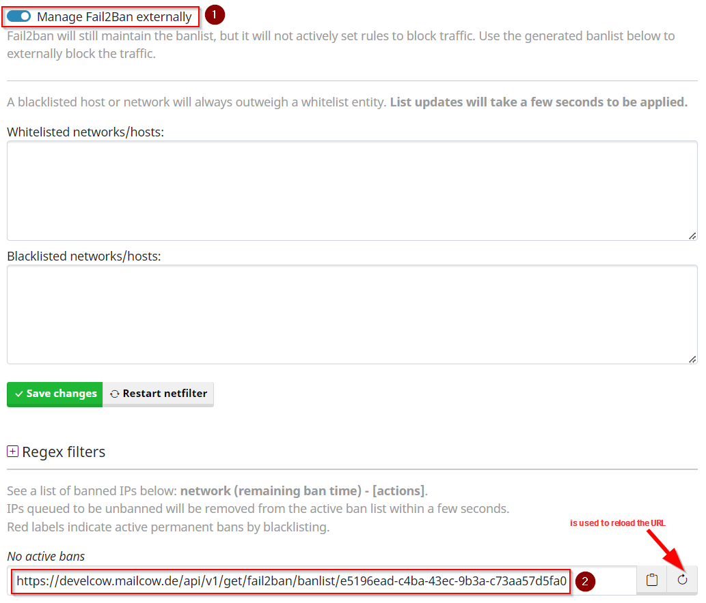

## How Netfilter works

The netfilter container reads the logs of the mailcow containers and counts failed logins per network. Once a network reaches the maximum number of attempts within the retry window, it is banned for the ban time.

- **Networks instead of single addresses:** the size of a banned network is set by the IPv4 and IPv6 netban prefixes (default `/32` and `/128`, i.e. single addresses).
- **Growing ban time:** with `Ban time is incremented with each ban` enabled, every further ban of the same network lasts twice as long, up to the maximum ban time. The doubling starts over after a restart of the netfilter container, active bans stay.
- **Private addresses** (e.g. `192.168.0.0/16` or the mailcow network) and loopback are never banned.
- **Active bans survive restarts:** they are stored in Redis together with their expiry. A restart of the netfilter container (e.g. by `update.sh`) applies them again, expired ones are dropped.
- **Unbanning:** expired bans and bans unbanned in the UI are lifted within about 10 seconds.

### What counts as a failed login

Counted:

- Failed logins to IMAP, POP3, SMTP (AUTH) and Sieve. Dovecot has the password checked by the mailcow UI, which reports the failure.
- Failed logins to ActiveSync and CalDAV/CardDAV, with the address of the client.
- Failed logins to the mailcow UI and SOGo, including wrong 2FA codes.
- Failed logins of Dovecot master users.

Logged, but **not** counted: logins with the right password that the account does not allow. The log of the php-fpm container shows them as `Login denied`, for example:

- the protocol is disabled for the mailbox, or the mailbox or domain is inactive,
- a shared mailbox, which has no login of its own,
- a mailbox with 2FA that uses its password instead of an app password in a mail client,
- an inactive app password, or one without the protocol.

So a misconfigured mail client does not get a whole network banned, e.g. an office behind NAT. Wrong passwords still count.

!!! warning "Reverse proxy"
	If mailcow runs behind a reverse proxy with an address outside the private ranges, add it to `TRUSTED_PROXIES` in `mailcow.conf`. Otherwise failed ActiveSync and CalDAV/CardDAV logins of all clients count for the address of the proxy, and the proxy gets banned.

## Change Netfilter Ban Settings

To change the Netfilter settings in general please navigate to: `Configuration -> Configuration & Details -> Configuration -> Fail2ban parameters`.

You should now see a familar interface:

Here you can set several options regarding the bans itself. 
For example the max. Ban time or the max. attempts before a ban is executed.

Changes take effect within about 10 seconds, without a restart.

### Allowlist and denylist

- **Allowlist:** addresses and networks that are never banned.
- **Denylist:** addresses and networks that are banned permanently. A denylist entry outweighs an allowlist entry.

Both lists also take hostnames, which are resolved to their IPv4 and IPv6 addresses. Netfilter applies changes within a minute, without a restart. If a hostname cannot be resolved for a while (DNS timeout), its last known addresses stay in place.

## Change Netfilter Regex

!!! danger
	The following area requires at least basic regex knowledge.  
	If you are not sure what you are doing there, we can only advise you not to attempt a reconfiguration.

In addition to the ban settings, you can also define what exactly should be used from the mailcow container logs to ban a possible attacker.

To do this, expand the regex field. There you can change the rules or add new ones. The default rules:

| ID | Log lines |
| --- | --- |
| 1 | Failed logins to the mailcow UI, ActiveSync and CalDAV/CardDAV, wrong 2FA codes |
| 2 | Failed logins to the Rspamd UI |
| 3 | Failed IMAP, POP3, SMTP and Sieve logins |
| 4 | Non-SMTP commands sent to Postfix |
| 5 | SMTP protocol errors |
| 6 | Failed SOGo logins |
| 7 | SOGo requests answered with `403` |
| 8 | Failed logins of Dovecot master users |

- The first group of a rule (`(...)`) must capture the client address.
- Rules are checked in order of their ID. A log line counts as one failed attempt, even if several rules match.
- A rule with an invalid regex is skipped and logged, the other rules keep working.

!!! info
	The default rules are anchored to the start of the log line (`^`), so text that clients control (e.g. a login name) cannot match. Anchor your own rules the same way.  
	Updates replace former default rules automatically if they were not changed. Rules you changed or added are kept: check them after an update. Failed SMTP logins come from rule 3 now, a rule for the Postfix log (`SASL ... authentication failed`) would count them twice. `Reset to default` restores the default rules.

## Identity provider outages

If mailcow cannot reach the identity provider (LDAP, Keycloak) during a login, the login fails with a temporary error and is **not** counted as a failed attempt:

- **mailcow UI:** shows "The identity provider is not reachable, please try again later."
- **IMAP/POP3:** mail clients get a temporary failure (`[UNAVAILABLE]`) and try again later.
- **SMTP:** the login fails, but is not counted.

Mail clients that logged in successfully before keep working during the outage, as long as Dovecot has their login in its cache.

## Firewall rules

Netfilter keeps its rules in the chain `MAILCOW`, which is jumped to as the first rule of the `INPUT` and `FORWARD` chains.

- **Order:** Docker puts its own jumps (`DOCKER-USER`, `DOCKER-FORWARD`) at the top when it restarts. Netfilter checks the order every 10 seconds and moves the `MAILCOW` jump back to the top. If the chain is missing (e.g. after a firewall reload on the host), Netfilter creates it again, including all active bans.
- **Isolation:** the rule `mailcow isolation` blocks access from outside the mailcow network to the ports of MariaDB, Redis, Solr and doveadm (3306, 6379, 8983, 12345). There is one rule per port, so tools that save and restore the ruleset with `iptables-save` (e.g. `netfilter-persistent`) keep the ports. The rule can be disabled with `DISABLE_NETFILTER_ISOLATION_RULE=y` in `mailcow.conf`; after a restart of the netfilter container existing rules are removed as well.
- **Stopping:** when the netfilter container stops, it removes its rules. The active bans stay in Redis and are applied again on the next start.

## Provide Netfilter decisions via URL as source for firewall block rules

!!! info
	However, the option is deactivated by default and must first be activated by you.

Since the 2023-12 update, mailcow offers the possibility to export the netfilter decisions as an external endpoint in order to be able to integrate the data from it into an external firewall system, quasi as a blocklist source.

??? question "What does this function do for me?"
	With this functionality, you can forward the IPs marked as blocked by Netfilter to an endpoint, which can then process these IPs. For example, an OPNsense firewall can dynamically load this list.

Let's take a look at these settings:

To activate the general function, the checkbox `Manage Fail2Ban externally` must be checked.

As soon as this is done, the URL (point 2) can be copied and pasted into the respective endpoint.

!!! warning "Important"
	The URL can be regenerated if required. To do this, click on the symbol next to Copy `Reload symbol`.
